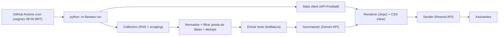

# Flamengo News — Plano do Projeto

Newsletter por e-mail, enviada **segunda** e **sexta** de manhã, com:
1. **Resumo das notícias** do Flamengo do período (coletadas de várias fontes e sumarizadas por LLM).
2. **Estatísticas da última partida** (placar, gols, escalação, posse, finalizações etc.).
3. **Próximo jogo** e **classificação** (Brasileirão / grupo da Libertadores).

---

## 1. Visão geral da arquitetura



Pipeline **stateless**: cada execução considera apenas a janela de tempo da edição.
Não há banco de dados na v1 (simplifica rodar no GitHub Actions).

### Janelas das edições
| Edição | Envio | Janela de notícias | Cobre |
|---|---|---|---|
| Segunda | seg 08:00 BRT | sex 08:00 → seg 08:00 | jogo do fim de semana (Brasileirão) |
| Sexta | sex 08:00 BRT | seg 08:00 → sex 08:00 | jogo do meio de semana (Libertadores / Copa do Brasil) |

A "última partida" = partida finalizada mais recente do Flamengo **dentro da janela**. Se não houver, a seção mostra apenas o próximo jogo.

---

## 2. Stack

| Camada | Escolha | Motivo |
|---|---|---|
| Linguagem | Python 3.12 + `uv` | ecossistema de scraping/LLM |
| HTTP | `httpx` | sync/async, fácil de mockar com `respx` |
| RSS | `feedparser` | padrão de mercado |
| Parsing HTML | `selectolax` (ou `beautifulsoup4`) | rápido |
| Extração de artigo | `trafilatura` | extrai texto limpo de qualquer página de notícia |
| LLM | Gemini API via `google-genai` (modelo Flash) | barato/free tier, bom em pt-BR |
| Dados de futebol | **API-Football** (api-sports.io, free: 100 req/dia) | cobre Brasileirão, Libertadores, Copa do Brasil, estatísticas por jogo |
| Fallback dados | football-data.org (free tier tem Brasileirão `BSA`) | opcional |
| Template | `jinja2` + `premailer` (CSS inline) | compatibilidade com clientes de e-mail |
| Envio | **Resend** (free: 3.000/mês) — alternativa: Brevo ou SMTP Gmail | API simples |
| Config | `pydantic-settings` + `.env` | validação de envs |
| CLI | `typer` | comandos `run`, `preview`, `collect`, `stats` |
| Testes | `pytest`, `respx`, fixtures HTML/JSON salvas | sem rede nos testes |
| Agendamento | GitHub Actions `schedule` | grátis, sem servidor |

---

## 3. Fontes de notícias

Prioridade: **RSS primeiro, scraping só onde não há RSS**. Respeitar `robots.txt`, usar `User-Agent` identificável, 1 req/s por domínio.

| Fonte | Método | Observação |
|---|---|---|
| Google News | RSS `https://news.google.com/rss/search?q=Flamengo+futebol&hl=pt-BR&gl=BR&ceid=BR:pt-419` | agrega muitas fontes; links redirecionam (resolver URL final) |
| ge.globo | scraping `https://ge.globo.com/futebol/times/flamengo/` | lista de manchetes do feed da página |
| Site oficial | `https://www.flamengo.com.br/noticias` | notícias oficiais (lesões, relacionados) |
| ESPN / Lance / UOL / Coluna do Fla | RSS se existir, senão scraping da página do clube | adicionar incrementalmente |

> Todas as URLs/seletores devem ser **verificadas na implementação** (sites mudam). Cada collector é isolado: se um falhar, o pipeline continua e loga o erro.

### Modelo de dados (`Article`)
```python
@dataclass
class Article:
    url: str  # URL canônica final
    title: str
    source: str  # "ge", "google_news", "flamengo_oficial"...
    published_at: datetime  # timezone-aware (America/Sao_Paulo)
    summary_hint: str | None = None  # descrição do RSS
    content: str | None = None  # texto extraído
```

### Dedupe
1. Normalizar URL (remover query de tracking `utm_*`, fragment).
2. Dedupe por URL.
3. Dedupe por título similar (`rapidfuzz` token_set_ratio ≥ 85) — mantém o de fonte com maior prioridade.

---

## 4. Sumarização (LLM)

Estratégia em 2 etapas para controlar custo e qualidade:

1. **Agrupamento/seleção** (1 chamada): enviar lista `[id, título, fonte, hint]` e pedir ao modelo para devolver **JSON** com até ~8 tópicos (`{"topic": str, "article_ids": [..], "importance": 1-5}`), descartando irrelevantes (outros clubes, fofoca, apostas).
2. **Resumo por tópico** (1 chamada por tópico ou 1 chamada em lote): com o texto extraído dos artigos do tópico, gerar um parágrafo de 2–4 frases em pt-BR, neutro, com links das fontes.
3. **Abertura** (opcional, 1 chamada): "Resumo da semana" em 2 frases + manchete da edição.

Regras de prompt:
- Saída sempre em **JSON validado com pydantic** (`response_mime_type="application/json"` + schema).
- Não inventar fatos; usar só o conteúdo fornecido.
- Limitar texto de cada artigo a ~4.000 caracteres.
- Retry com backoff (`tenacity`) e timeout.
- Prompts em arquivos `src/flanews/prompts/*.md` (fáceis de ajustar).

Modelo configurável via env `GEMINI_MODEL` (padrão: um modelo Flash disponível na data).

---

## 5. Estatísticas (API-Football)

Base: `https://v3.football.api-sports.io`, header `x-apisports-key`.

| Dado | Endpoint | Observação |
|---|---|---|
| Últimos jogos | `GET /fixtures?team={FLA_ID}&last=3` | pegar o mais recente finalizado na janela |
| Próximo jogo | `GET /fixtures?team={FLA_ID}&next=1` | |
| Estatísticas do jogo | `GET /fixtures/statistics?fixture={id}` | posse, chutes, escanteios, faltas, cartões |
| Eventos (gols, cartões, subs) | `GET /fixtures/events?fixture={id}` | |
| Escalações | `GET /fixtures/lineups?fixture={id}` | |
| Classificação | `GET /standings?league={LEAGUE}&season={YEAR}` | Brasileirão=71, Libertadores=13 (verificar) |

IDs a **confirmar** na Task de stats: Flamengo `team=127`, Brasileirão `league=71`, Libertadores `league=13`, Copa do Brasil `league=73`.
Orçamento: ~6–8 requisições por edição → bem abaixo do limite de 100/dia.

Se a API falhar ou a chave não estiver configurada, a seção de estatísticas é omitida (newsletter ainda sai).

---

## 6. Newsletter (e-mail)

Estrutura do HTML (mobile-first, largura máx. 600px, cores rubro-negras):
1. Cabeçalho: "Flamengo News — Edição de Segunda, 13/10/2026"
2. Abertura (2 frases)
3. **Última partida**: placar, competição, gols (minuto + autor), mini tabela de estatísticas, nota sobre destaque
4. **Notícias**: cards por tópico (título, resumo, links "Fontes: ge, ESPN")
5. **Próximo jogo**: adversário, data/hora BRT, competição, local
6. **Classificação**: posição do Flamengo + 2 acima/2 abaixo
7. Rodapé: link de descadastro (mailto ou Resend audience), aviso "gerado com IA"

Também gerar versão **texto puro** (fallback multipart).

Assinantes v1: lista em env `NEWSLETTER_RECIPIENTS` (separados por vírgula) ou Resend Audience. v2: página de inscrição.

---

## 7. Estrutura de diretórios

```
flamengo-news/
├── AGENTS.md
├── README.md
├── pyproject.toml
├── .env.example
├── .github/workflows/
│   ├── ci.yml              # lint + testes em PR/push
│   └── newsletter.yml      # cron seg/sex
├── docs/
│   ├── PLAN.md
│   └── TASKS.md
├── src/flanews/
│   ├── __init__.py
│   ├── __main__.py         # typer app
│   ├── config.py           # Settings (pydantic-settings)
│   ├── models.py           # Article, Topic, MatchStats, Edition...
│   ├── edition.py          # cálculo de janela/tipo de edição
│   ├── collectors/
│   │   ├── base.py         # Protocol Collector + registry
│   │   ├── google_news.py
│   │   ├── ge.py
│   │   └── flamengo_oficial.py
│   ├── processing/
│   │   ├── dedupe.py
│   │   └── extract.py      # trafilatura
│   ├── summarizer/
│   │   ├── client.py       # wrapper Gemini
│   │   └── pipeline.py     # agrupar → resumir
│   ├── prompts/*.md
│   ├── stats/
│   │   └── api_football.py
│   ├── render/
│   │   ├── renderer.py
│   │   └── templates/newsletter.html.j2, newsletter.txt.j2
│   ├── send/
│   │   └── resend_sender.py
│   └── pipeline.py         # orquestra tudo
└── tests/
    ├── fixtures/           # html, rss, json salvos
    └── test_*.py
```

---

## 8. Variáveis de ambiente

```
GEMINI_API_KEY=
GEMINI_MODEL=gemini-flash-latest
API_FOOTBALL_KEY=
FLAMENGO_TEAM_ID=127
RESEND_API_KEY=
NEWSLETTER_FROM="Flamengo News <news@seudominio.com>"
NEWSLETTER_RECIPIENTS=voce@email.com
TIMEZONE=America/Sao_Paulo
DRY_RUN=true
```

---

## 9. CLI

```
uv run python -m flanews collect  [--edition monday|friday] [--date YYYY-MM-DD]   # lista artigos coletados
uv run python -m flanews stats    [--date ...]                                    # imprime stats da última partida
uv run python -m flanews preview  [--edition ...] [--out out/preview.html]        # pipeline completo sem enviar
uv run python -m flanews run      [--edition auto]                                # pipeline completo + envio
```
`--edition auto` deduz pelo dia da semana (seg → monday, sex → friday).

---

## 10. Agendamento

GitHub Actions (cron em UTC; BRT = UTC-3):
```yaml
on:
  schedule:
    - cron: "0 11 * * 1"   # seg 08:00 BRT
    - cron: "0 11 * * 5"   # sex 08:00 BRT
  workflow_dispatch:
```
Upload do HTML gerado como artifact do workflow (auditoria).

---

## 11. Roadmap futuro (fora da v1)
- Envio "smart": disparar X horas após o fim de cada jogo em vez de dias fixos.
- Página de inscrição (Cloudflare Pages + Resend Audiences).
- SQLite/Turso para histórico e evitar repetir notícias entre edições.
- Seção "Mercado da bola" e "Departamento médico".
- Gráficos (matplotlib → PNG embutido).

---

## 12. Decisões
| Data | Decisão | Motivo |
|---|---|---|
| 2026-10-14 | Pipeline stateless, sem DB na v1 | simplicidade no GitHub Actions |
| 2026-10-14 | Gemini Flash para sumarização | custo baixo, pt-BR bom |
| 2026-10-14 | API-Football para estatísticas | cobre todas as competições do Flamengo |
| 2026-10-14 | Resend para envio | API simples, free tier suficiente |
